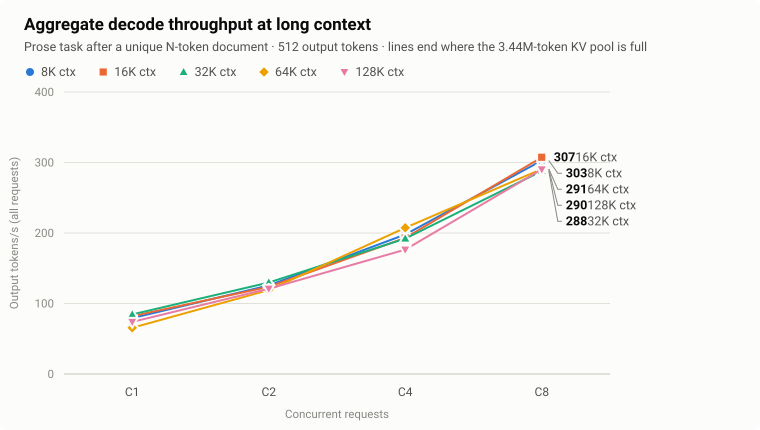

# HY-4-Flash-NVFP4 on 2× RTX PRO 6000 Blackwell

Serving the community NVFP4 build [**Avifenesh/Hy4-flash-NVFP4**](https://huggingface.co/Avifenesh/Hy4-flash-NVFP4) of Tencent's Hy4-flash (220B MoE, 512 experts / 16 active, sparse MLA + sliding-window attention, Engram n-gram memory) with vLLM. It runs on two **RTX PRO 6000 Blackwell Workstation** GPUs (SM120, 96 GB each, power-limited to **450 W**) at tensor parallel 2, with a **512K context window**. Speculative decoding uses **Tencent's own FP8 DFly drafter** from [tencent/Hy4-flash-FP8](https://huggingface.co/tencent/Hy4-flash-FP8).

> **Status: V2.** Two optimization passes over the baseline ([V1](#v1-vs-baseline), [V2](#v2-vs-v1)): decode is 23–65% faster than the baseline in the short-prompt matrix and prefill about 10% faster, with the same weights and no new quantization. The FP8 sibling setup is at [hyudryu/HY-4-Flash-FP8-2xRTXPro6000](https://github.com/hyudryu/HY-4-Flash-FP8-2xRTXPro6000).

The stock `vllm/vllm-openai:hy4-flash` image refuses this model on SM120 and can't load this checkpoint. This repo has a ten-file overlay patch that fixes both, the launch recipe, and measured speeds.

## TL;DR

| | Baseline | V1 | **V2** | FP8 ([sibling](https://github.com/hyudryu/HY-4-Flash-FP8-2xRTXPro6000)) |
|---|---|---|---|---|
| Decode, 1 user: prose / coding / counting | 75 / 103 / 132 | 92 / 120 / 142 | **117 / 159 / 162** tok/s | 62 / 87 / 106 |
| Decode, 8 users aggregate: prose / coding / counting | 287 / 372 / 439 | 416 / 519 / 610 | **474 / 583 / 670** tok/s | 211 / 274 / 347 |
| Decode at 128K context, 8 users aggregate | 290 | 396 | **461 tok/s** | — (didn't fit) |
| Prefill (median, 16K–64K) | ~5,130–5,155 | ~5,389–5,406 | **~5,666–5,672 tok/s** | ~5,200–5,370 |
| Decode step latency, 1 user | 26.5 ms | 20.3 ms | **16.4 ms** | — |
| GPU kernel launches per decode step | ~10,700 | ~7,800 | **~4,200** | — |
| Context window / KV pool | 524,288 / 3.45M tokens | same | same | 262,144 / 308K tokens |
| Weights per GPU / pinned host RAM | 50.1 GiB / ~62 GiB | same | same | 80.8 GiB / ~118 GiB |

Decode numbers include DFly speculative decoding and count reasoning tokens. Sampling is greedy (temperature 0).

## V1 vs baseline

V1 is the baseline plus four changes. None changes the weights or adds quantization.

| # | Change | What it does | Effect |
|---|---|---|---|
| 1 | **Fused RMSNorm** (`--ir-op-priority`, one flag) | vLLM picked its unfused "native" RMSNorm, expecting `torch.compile` to fuse it, but this model doesn't support `torch.compile`. So each of the ~290 norms per step ran as 8 tiny kernels. The flag selects vLLM's own fused C kernel. | ~2,000 fewer kernel launches per step; decode step 26.5 → 24.0 ms |
| 2 | **Sliding-window index cache** (`swa.py`) | All 30 sliding-window layers recomputed the same window indices every step (~30 tiny kernels each). They depend only on the batch, so they're now computed once per forward pass and copied. The result is bit-identical. | 24.0 → 23.0 ms |
| 3 | **3 draft tokens instead of 5** | Every drafted token is verified by the full model, and that cost grows with batch size. Draft positions 4–5 were accepted only 8–12% of the time. | 23.0 → 20.3 ms at 1 user; ~50 → ~36 ms at 8 users |
| 4 | **MoE kernel A/B** | b12x (SM120 W4A16) was tested against Marlin and was equivalent within noise, so V1 stays on Marlin. | none |

**How it was found:** a `torch.profiler` trace of one decode step (per-kernel GPU time on both TP ranks) showed about **10,700 kernel launches per step**. Tiny unfused elementwise ops were the largest slice at 32% of step time. Dense BF16 GEMMs took 21%, the Marlin MoE GEMM 13%, sparse-MLA attention 11%, DeepGEMM 10%, the LM head 4.5%, and TP all-reduce 4.3% with no wait gaps.

**Speculative decoding:** per-draft-token acceptance rose from 25.9% to **38.6%** over the full benchmark, because the low-yield positions are no longer drafted. Tokens per step went from 2.29 to 2.16, while each step got 23–28% cheaper. In the baseline, acceptance by position was 58% / 33% / 19% / 12% / 8%. A sweep of 2, 3, 4, 5 and 8 draft tokens put 3 on top at both 1 and 8 users.

**Output:** changes 2–4 don't alter the model's math. The fused RMSNorm computes the same function but rounds once instead of twice, so text can diverge from the baseline after a few dozen tokens. Baseline-vs-baseline runs diverge the same way. The smoke tests still pass.

## V2 vs V1

V2 is V1 plus two kernel fusions. Neither changes the weights, the draft settings, or any precision.

| # | Change | What it does | Effect |
|---|---|---|---|
| 1 | **Fused rotary embedding** (`attention.py`, `model.py`) | Every layer applied M-RoPE to q and k as ~36 tiny torch kernels (select cos/sin per axis, strided multiply/add, stack, concatenate). The per-token cos/sin rows depend only on the positions, so they're now built once per forward pass for each of the two rotary tables, and vLLM's C rotary kernel rotates q and k in place in one launch. This is the path the base HY4 model already uses. | ~1,700 fewer kernel launches per step; decode step 20.3 → 18.4 ms |
| 2 | **Fused IndexPool kernels** (`indexpool_fused.py`, `compressed_indexer.py`) | In each of the 12 sparse layers, the compressed indexer rotated, Walsh–Hadamard-transformed and FP8-quantized its keys and its queries with ~90 tiny kernels per call (twice per layer), then expanded the selected groups into token indices with ~35 more. Two Triton kernels now do each job in one launch. | ~1,900 fewer launches per step; 18.4 → 16.4 ms |

**How it was found:** a fresh profile of V1 showed a sliding-window layer costing about 405 µs of GPU time and a sparse layer about 700 µs. Most of the sparse layers' extra was ~240 one-microsecond glue kernels in the indexer. After V2 those are about 335 µs and 460 µs, and a decode step is about 4,200 kernel launches, down from 7,800 in V1 and 10,700 in the baseline. The step is now dominated by GEMMs that are bound by memory bandwidth.

**Output:**
- **The IndexPool kernels are bit-identical to the code they replace.** [`tests/test_indexpool_fused.py`](tests/test_indexpool_fused.py) compares quantized bytes, scales and expanded indices against the reference implementation: 0 mismatches. Getting there needed three details: the same butterfly order, a guard against the compiler fusing multiply-add into FMA, and an explicit round-to-nearest-even FP8 cast.
- **The fused rotary kernel is not bit-identical; it's more accurate.** The original rounded to BF16 three times per element (two products, then the sum), and the C kernel rounds once. Against an exact reference, the fused result is the correctly rounded BF16 value 100% of the time, versus 69% for the original ([`tests/test_rope_fused.py`](tests/test_rope_fused.py)). As with V1's fused RMSNorm, sampled text can diverge from V1 after a few dozen tokens.
- Smoke tests pass, and two-needle recall is exact at 6.6K, 68K and 206K tokens.

**Acceptance was investigated and is unchanged.** The same FP8 drafter was measured against the FP8 target on this machine. Its first-draft-token acceptance there (54% prose / 68% coding / 73% counting) matches the NVFP4 target (55% / 70% / 73%), and so do positions 2–5. So the 4-bit expert weights are not what limits acceptance; the limit is the drafter itself, or the SM120 FP8 KV path that both targets share. Each later position is accepted at a roughly constant conditional rate (about 45% prose, 65% coding, 73% counting), so there's no setting that raises it losslessly.

**Measured and ruled out:**
- DeepGEMM's split-K reduce looked as expensive as its GEMM in the trace (0.9 ms per step). It's launched early and waits on the GEMM, so that time is overlap, not cost.
- The LM head (3 draft passes and 1 target pass, about 1 ms per step) reads the whole vocabulary matrix each pass and is bound by memory bandwidth. The draft passes can't be batched, because each depends on the previous draft token.

## Hardware and software

| Component | Version |
|---|---|
| GPUs | 2× NVIDIA RTX PRO 6000 Blackwell Workstation Edition (SM120, 97,887 MiB each), PCIe, no NVLink |
| GPU power limit | **450 W each** (default and max is 600 W) |
| CPU / RAM | AMD Ryzen Threadripper PRO 9965WX (24C/48T), 256 GB RAM (`free` reports 215 GiB usable) |
| Driver / CUDA | 595.99.02 / CUDA 13.2 driver, CUDA 13.0 in the image |
| Image | `vllm/vllm-openai:hy4-flash` = `sha256:6b645bfbf4b89602d38f6e93c1c418516ec0bfbf54b64cd661b8075bfec01da1` |
| vLLM / FlashInfer / PyTorch | 0.1.dev25463+g77766db1f / 0.7.4 / 2.14.0+cu130 |
| Target model | [`Avifenesh/Hy4-flash-NVFP4`](https://huggingface.co/Avifenesh/Hy4-flash-NVFP4) @ `f9eac06cf022cfd3dc2e8ed423922466b2adcd87` |
| Draft model | DFly drafter from [`tencent/Hy4-flash-FP8`](https://huggingface.co/tencent/Hy4-flash-FP8) @ `bd0e136e89a9ecd5ea17668cd89cf54fa127e795` (only `model.dfly_layers.*` is read, ~0.9 GiB) |
| Base model | [`tencent/Hy4-flash`](https://huggingface.co/tencent/Hy4-flash) |
| OS | Linux 7.0.0 (Ubuntu) |

## The checkpoint

`Avifenesh/Hy4-flash-NVFP4` is a data-free, weight-only quantization of the BF16 `tencent/Hy4-flash`, made by a third party, not Tencent. Its own card reports 0.66% relative weight error on the experts.

| Weight class | Format | Size | Lives in |
|---|---|---|---|
| Routed experts (41 MoE layers × 512) | NVFP4 weight-only (E2M1 + E4M3 per-16 scale + FP32 per-expert scale) | 77.8 GiB | VRAM (TP2) |
| Engram n-gram tables (4) | FP8 E4M3, one FP32 scale per row | 61.5 GiB | **Pinned host RAM** |
| `q_b_proj` / `o_proj` / `linear_gate` | FP8, 128×128 blocks | | VRAM |
| Everything else (dense layer 0, shared experts, router, indexer, norms, embeddings, LM head) | BF16, unchanged | 9.2 GiB total for this row and the one above | VRAM |
| Vision tower | BF16 | 0.9 GiB | VRAM |
| Built-in DFly drafter | NVFP4 MLPs + FP8 attention | 0.7 GiB | **not used**; replaced by the vendor FP8 drafter |

Activations stay BF16. The experts run through vLLM's Marlin W4A16 kernel (`--moe-backend marlin`), so there is no activation quantization.

## What's where: VRAM, RAM, and the context pool

**Per GPU (VRAM, 95.6 GiB usable, capped at 90.2 GiB by `--gpu-memory-utilization 0.95`):**

| Item | Size per GPU |
|---|---|
| Model weights (NVFP4 experts ~38.9 GiB + FP8/BF16 dense, attention, vision, LM head), plus the FP8 DFly drafter | **50.1 GiB** |
| KV cache pool | **36.5 GiB → 3,440,895 tokens** |
| CUDA graphs | ~0.37 GiB |
| Encoder (image) cache | 0.05 GiB, taken from the KV pool |
| Total in use (`nvidia-smi`) | ~89–91 GiB |

**Host RAM:** the four Engram tables (~165M rows × 96 each) sit in **pinned host memory**. The GPUs read them over PCIe through UVA, which is vLLM's default for this model. They're stored as FP8 with FP32 row scales, about **62 GiB** (`free` shows ~68 GB shared), roughly half of what the FP8 sibling needs (BF16 tables, ~118 GiB).

**Context pool:** the KV cache uses the packed `fp8_ds_mla` layout, the only layout the SM120 sparse-MLA kernel reads. 30 of the 42 layers are sliding-window (512 tokens), so only the 12 sparse-attention layers grow with the sequence. With `--max-model-len 524288` the pool holds **6.56 full-length requests** at once, or any mix that stays under ~3.44M tokens, for example 8 × 128K with room to spare. A 448,719-token prompt with codes planted at the start and middle was recalled exactly.

## Recipe

### 1. Download both checkpoints

```bash
huggingface-cli download Avifenesh/Hy4-flash-NVFP4 --revision f9eac06cf022cfd3dc2e8ed423922466b2adcd87
# DFly drafter: the whole drafter lives in one 0.91 GiB shard of the 268 GB FP8 checkpoint.
# (This partial download is untested here; the benchmarks used a full local copy.)
huggingface-cli download tencent/Hy4-flash-FP8 --revision bd0e136e89a9ecd5ea17668cd89cf54fa127e795 \
  --include "*.json" "*.jinja" "model-00148-of-00148.safetensors"
docker pull vllm/vllm-openai:hy4-flash
```

### 2. Run it

```bash
git clone https://github.com/hyudryu/HY-4-Flash-NVFP4-2xRTXPro6000
cd HY-4-Flash-NVFP4-2xRTXPro6000
./recipe/run.sh            # extra vLLM flags can be appended
docker logs -f hy4-flash-nvfp4
```

[`recipe/run.sh`](recipe/run.sh) bind-mounts the ten patch files read-only over the image and runs:

```bash
vllm serve Avifenesh/Hy4-flash-NVFP4 --revision f9eac06cf022cfd3dc2e8ed423922466b2adcd87 \
  --served-model-name hy4-flash-nvfp4 --tensor-parallel-size 2 --dtype bfloat16 \
  --gpu-memory-utilization 0.95 --moe-backend marlin \
  --max-model-len 524288 --max-num-seqs 8 --max-num-batched-tokens 8192 \
  --limit-mm-per-prompt '{"image":1,"video":0}' \
  --speculative-config '{"method":"dfly","num_speculative_tokens":3,"model":"tencent/Hy4-flash-FP8","revision":"bd0e136e89a9ecd5ea17668cd89cf54fa127e795","draft_sample_method":"greedy"}' \
  --enable-auto-tool-choice --reasoning-parser hy_v4 --tool-call-parser hy_v4 \
  --ir-op-priority '{"rms_norm":["vllm_c"],"fused_add_rms_norm":["vllm_c"]}' \
  --enable-prompt-tokens-details
# env: HF_HUB_OFFLINE=1 VLLM_USE_RUST_FRONTEND=1
```

Startup takes about 2 minutes of weight loading on a cold page cache (~40 s when warm), then about 5 minutes of warmup and CUDA-graph capture. Test it:

```bash
curl -s localhost:8000/v1/chat/completions -H 'Content-Type: application/json' \
  -d '{"model":"hy4-flash-nvfp4","messages":[{"role":"user","content":"What is 17*23?"}]}'
```

**Do not pass:**
- `--attention-backend` (FlashMLA has no SM120 kernels).
- `--kv-cache-dtype fp8`. Leave it at `auto`; it becomes `fp8_ds_mla` automatically.
- A speculative config **without** the `model`/`revision` of the FP8 checkpoint. Without them, vLLM tries the checkpoint's own NVFP4 drafter, which this image can't load.

`draft_sample_method` is set to `greedy` explicitly because the NVFP4 `config.json` carries a `speculative_config` hint with `probabilistic`, and vLLM's DFly accepts only greedy drafts.

### Optional: running under a manager (SparkDeck, etc.)

Use the same flags, with the ten files as read-only mounts. Each source is `/path/to/repo/patch/vllm/models/<file>`; each target is `/usr/local/lib/python3.12/dist-packages/vllm/models/<file>`, for `<file>` in:

```
hy_v4_flash/nvidia/sm120.py      hy_v4_flash/nvidia/attention.py   hy_v4/nvidia/attention.py
hy_v4_flash/nvidia/model.py      hy_v4_flash/nvidia/engram.py      hy_v4_flash/nvidia/nvfp4_fold.py
hy_v4/dfly_config.py             hy_v4_flash/nvidia/swa.py         hy_v4_flash/nvidia/compressed_indexer.py
hy_v4_flash/nvidia/indexpool_fused.py
```

In SparkDeck, cloning an FP8 deployment carries over its DFly launch controls. Make sure the speculative config is the one above, and set its draft-token control to 3.

## The patch

Files are in [`patch/`](patch/), and diffs against the image are in [`patch/diffs/`](patch/diffs/).

**SM120 attention.** These three files are identical to the [FP8 repo's patch](https://github.com/hyudryu/HY-4-Flash-FP8-2xRTXPro6000#the-sm120-patch), and follow the same approach as upstream draft [vllm#68387](https://github.com/vllm-project/vllm/pull/68387) for [vllm#68380](https://github.com/vllm-project/vllm/issues/68380):
1. **`hy_v4_flash/nvidia/sm120.py` (new):**
   - Hy4 runs on FlashInfer's `FLASHINFER_MLA_SPARSE_SM120` kernel, with the per-head learnable attention sink passed through.
   - The `fp8_ds_mla` scales are read as `arbitrary_fp32`.
2. **`hy_v4_flash/nvidia/attention.py`:**
   - Accepts compute capability 12.x.
   - Sets the sliding window after construction, so the 30 SWA layers can use `fp8_ds_mla`.
3. **`hy_v4/nvidia/attention.py`:** gives the DFly drafter the same sink-capable SM120 backend.

**NVFP4 checkpoint loading:**

4. **`hy_v4_flash/nvidia/model.py`:**
   - Accepts the checkpoint's ModelOpt `MIXED_PRECISION` config (`modelopt_mixed`), with W4A16_NVFP4 and FP8_PB_WO layers only.
   - Loads stacked `[512, …]` expert tensors, including the 1-D per-expert `weight_scale_2`.
   - Renames the FP8 block scale `weight_scale_inv` to ModelOpt's `weight_scale`.
   - Fills the unused W4A16 input scales with 1.0.
   - Loads the pre-quantized FP8 Engram tables.
5. **`hy_v4_flash/nvidia/engram.py`:** keeps the Engram row scales in **FP32**, never rounded to BF16.
6. **`hy_v4_flash/nvidia/nvfp4_fold.py` (new):** vLLM's NVFP4 MoE path keeps one global scale per expert for gate and up together. The checkpoint stores them separately, and they differ by 2× in 182 of 20,992 experts.
   - This file folds the difference into the per-16 block scales and E2M1 codes. That's exact for all but a few experts in layers 1–2.
   - For those few, E4M3 limits force rounding some block scales. Worst relative error is **3.5e-6**, about 1/1900 of NVFP4's own quantization error, and the loader logs a warning.

**External FP8 drafter:**

7. **`hy_v4/dfly_config.py`:**
   - Allows a `modelopt_mixed` target to take its DFly drafter from a different checkpoint, here the vendor FP8 one.
   - The drafter's config is derived from that checkpoint's own config, so it keeps the FP8 checkpoint's blockwise `quantization_config`, and it loads that checkpoint's weights.
   - Everything else behaves as before. The override is a module-level function plus `partial`, so the engine config still pickles across worker processes.

**V1 performance:**

8. **`hy_v4_flash/nvidia/swa.py`:** caches the sliding-window indices once per forward pass.
   - It's keyed on the forward-context object and the batch's `query_start_loc` / `seq_lens` tensors, so a different pass or batch never matches.
   - The other 29 SWA layers copy the cached result.
   - A one-time log line, `Flash SWA window-index cache: hit=True`, confirms it's active.

The fused RMSNorm is a launch flag (`--ir-op-priority`), not a patch.

**V2 performance:**

9. **`hy_v4_flash/nvidia/attention.py` and `model.py` (rotary):** `HYV4FlashModel.forward` builds the per-token M-RoPE cos/sin rows once per pass for each distinct rotary table; the attention forward then calls vLLM's C rotary kernel on the strided q and k views.
10. **`hy_v4_flash/nvidia/indexpool_fused.py` (new) and `compressed_indexer.py`:**
    - `rotate_fwht_quantize`: rotation, the 7-stage Walsh–Hadamard butterfly, the power-of-two scale and the FP8 E4M3 cast in one Triton kernel. It also writes the query bytes straight into the zero-padded 32-head layout the scoring kernel wants.
    - `expand_groups_into`: selected group ids to token indices with stable compaction, written straight into the top-k buffer.
    - Anything outside the tested layout (non-interleaved M-RoPE, a rotary width other than 64, a different top-k width) falls back to the original code.

### Accuracy notes

- **Experts are third-party NVFP4** (weight-only, data-free). The Engram tables are FP8 per row.
- On SM120 the KV cache is FP8 (`fp8_ds_mla`), and the attention math is FP8 too. See the [FP8 repo](https://github.com/hyudryu/HY-4-Flash-FP8-2xRTXPro6000#accuracy-notes).
- **The drafter is Tencent's FP8 one**, not the checkpoint's NVFP4 one. Speculative decoding is verified by the target, so the drafter affects speed only, never output.
- Smoke tests:
  - 17×23 = 391; Canberra; a correct palindrome function; 14:35 + 2 h 50 m = 17:25.
  - No repetition loops.
  - Exact recall at 4,850 tokens and at **448,719 tokens** (two codes, start and middle). V2 was rechecked at 6.6K, 68K and 206K tokens.
- **No full-benchmark evaluation (GSM8K, GPQA, …) has been run yet.**

## Benchmarks

Method: [`bench/bench.py`](bench/bench.py), the same as the FP8 repo, plus a per-run `--seed-offset` so the 3.4M-token prefix cache can never serve a repeated prompt.
- Sampling is greedy, and token counts come from the server's usage stats.
- Decode tok/s is measured only while every request in the batch is decoding, so prefills are excluded. "Per user" is the median request's tokens after its first token divided by time after its first token.
- Raw results, run logs, and 1 Hz GPU power logs are in [`bench/results/`](bench/results/): `baseline/`, `v1/` and `v2/`. The tables are generated by [`bench/make_tables.py`](bench/make_tables.py); the change column compares V2 with the baseline.

### Prompt processing (prefill), single request, warm

| Prompt tokens | Baseline tok/s | V1 tok/s | V2 tok/s | Change | Time to first token (s) |
|---|---|---|---|---|---|
| 1,029 | 2,860 | 2,859 | **3,013** | +5% | 0.34 |
| 4,069 | 4,521 | 4,660 | **4,791** | +6% | 0.85 |
| 8,085 | 4,845 | 5,095 | **5,306** | +10% | 1.53 |
| 16,361 | 5,133 | 5,406 | **5,666** | +10% | 2.89 |
| 32,795 | 5,155 | 5,389 | **5,672** | +10% | 5.78 |
| 65,255 | 5,138 | 5,405 | **5,666** | +10% | 11.57 |
| 130,772 | 4,926 | 5,168 | **5,387** | +9% | 24.24 |

Median of **5 sweeps** after a JIT warm-up for every version; per-run data is in `bench/results/*/results-prefill-warm{1..5}.json`. Prefill hasn't been a target yet; the gain comes from the same kernel fusions.

### Decode at concurrency 1 / 2 / 4 / 8 (short prompts, 1,024 output tokens)

<picture>
  <source media="(prefers-color-scheme: dark)" srcset="docs/charts/decode-aggregate-dark.svg">
  
</picture>

<picture>
  <source media="(prefers-color-scheme: dark)" srcset="docs/charts/decode-per-user-dark.svg">
  
</picture>

| Workload | C | Baseline tok/s | V1 tok/s | V2 tok/s | Change | Per-user tok/s | TTFT p50 (s) |
|---|---|---|---|---|---|---|---|
| Prose (short story) | 1 | 75.3 | 92.1 | **117.4** | +56% | 117.4 | 0.13 |
|  | 2 | 123.1 | 160.9 | **196.8** | +60% | 98.2 | 0.50 |
|  | 4 | 193.5 | 273.1 | **316.2** | +63% | 79.0 | 0.53 |
|  | 8 | 286.7 | 416.0 | **473.6** | +65% | 59.5 | 0.50 |
| Coding (Python + tests) | 1 | 103.1 | 120.2 | **158.8** | +54% | 158.8 | 0.13 |
|  | 2 | 157.2 | 201.7 | **251.4** | +60% | 126.4 | 0.21 |
|  | 4 | 243.0 | 328.0 | **397.8** | +64% | 100.1 | 0.53 |
|  | 8 | 371.6 | 519.1 | **583.2** | +57% | 73.4 | 1.00 |
| Counting (1…400 in words) | 1 | 132.4 | 141.7 | **162.4** | +23% | 162.4 | 0.13 |
|  | 2 | 224.3 | 239.2 | **282.5** | +26% | 142.3 | 0.19 |
|  | 4 | 312.5 | 393.5 | **466.8** | +49% | 119.7 | 0.48 |
|  | 8 | 439.4 | 610.4 | **669.7** | +52% | 84.1 | 0.67 |

Medians of 2 rounds per cell. Solid lines in the charts are V2 and dashed lines are the baseline. Across the whole V2 benchmark the FP8 drafter's acceptance was **38.5% per draft token** (60% / 35% / 21% by position), about **2.16 tokens per decode step** with 3 drafted, the same as V1.

### Decode at context 8K → 128K (prose task after a unique N-token document, 512 output tokens)

<picture>
  <source media="(prefers-color-scheme: dark)" srcset="docs/charts/decode-context-dark.svg">
  
</picture>

| Context | C | Baseline tok/s | V1 tok/s | V2 tok/s | Change | Per-user tok/s | TTFT p50 (s) |
|---|---|---|---|---|---|---|---|
| 8K | 1 | 79.3 | 96.1 | **112.5** | +42% | 112.5 | 1.6 |
| 8K | 2 | 125.6 | 150.6 | **194.6** | +55% | 98.1 | 2.9 |
| 8K | 4 | 197.8 | 265.6 | **326.3** | +65% | 68.2 | 4.6 |
| 8K | 8 | 302.9 | 433.6 | **485.3** | +60% | 43.2 | 8.2 |
| 16K | 1 | 82.1 | 92.3 | **117.4** | +43% | 117.4 | 2.9 |
| 16K | 2 | 123.6 | 167.4 | **183.5** | +48% | 82.0 | 5.1 |
| 16K | 4 | 193.0 | 266.3 | **316.1** | +64% | 57.0 | 8.6 |
| 16K | 8 | 307.3 | 427.0 | **483.7** | +57% | 29.4 | 14.3 |
| 32K | 1 | 84.5 | 91.6 | **103.2** | +22% | 103.2 | 5.7 |
| 32K | 2 | 129.8 | 155.6 | **195.6** | +51% | 72.7 | 8.6 |
| 32K | 4 | 192.0 | 261.6 | **317.6** | +65% | 35.0 | 14.3 |
| 32K | 8 | 288.0 | 404.7 | **468.0** | +62% | 18.7 | 26.6 |
| 64K | 1 | 65.5 | 93.8 | **126.5** | +93% | 126.5 | 12.2 |
| 64K | 2 | 119.2 | 151.3 | **196.9** | +65% | 60.3 | 17.7 |
| 64K | 4 | 207.3 | 268.5 | **306.9** | +48% | 22.0 | 29.5 |
| 64K | 8 | 290.8 | 424.0 | **470.0** | +62% | 10.2 | 53.9 |
| 128K | 1 | 73.9 | 91.5 | **108.0** | +46% | 108.0 | 24.9 |
| 128K | 2 | 121.0 | 154.6 | **181.8** | +50% | 54.8 | 37.1 |
| 128K | 4 | 176.5 | 247.5 | **299.1** | +70% | 12.6 | 61.2 |
| 128K | 8 | 290.3 | 395.8 | **460.7** | +59% | 5.5 | 112.2 |

Thanks to sparse attention, aggregate decode speed barely depends on context: about 461–485 tok/s at C8 from 8K to 128K. Per-user tok/s at higher C is much lower than aggregate ÷ C, because each request's decode overlaps the other requests' prefills. TTFT at high C is dominated by those queued prefills: 8 × 128K is about 1M prompt tokens.

### Power (450 W limit per GPU, 1 Hz `nvidia-smi` samples)

| Phase | GPU 0 avg / max | GPU 1 avg / max | Peak temp (GPU 0 / 1) |
|---|---|---|---|
| Prefill sweeps (5×, warm) | 398 / 442 W | 399 / 446 W | 69 / 81 °C |
| Decode, C1–C8 | 370 / 415 W | 385 / 429 W | 63 / 77 °C |
| Long-context decode | 417 / 439 W | 410 / 465 W | 70 / 83 °C |

V2 run. Decode draws more than it did in V1 (330 / 345 W average). Idle is about 20–30 W per GPU with the model loaded. GPU 1 is the top card and runs about 12 °C hotter. Power logs for the other versions are in their `bench/results/` folders.

### Reproduce

```bash
cd bench
POOL=<KV pool tokens from the server log> OUT=results/myrun ./run_all.sh   # warm-up, 5 prefill sweeps, decode matrix, context sweep, GPU power log
RESULTS=myrun python3 make_charts.py   # regenerates docs/charts/*.svg; draws results/baseline dashed
python3 make_tables.py baseline v1 v2 myrun   # the README tables, oldest run on the left
```

Kernel exactness tests, run inside the image with this repo mounted at `/repo`:

```bash
docker run --rm --gpus all -v "$PWD:/repo" --entrypoint python3 vllm/vllm-openai:hy4-flash /repo/tests/test_indexpool_fused.py
docker run --rm --gpus all -v "$PWD:/repo" --entrypoint python3 vllm/vllm-openai:hy4-flash /repo/tests/test_rope_fused.py
```

## Optimization targets

After V2 a decode step is about 16.4 ms and 4,200 kernel launches at 1 user (about 32 ms at 8 users). Dense GEMMs that read whole weight matrices now dominate, so the remaining lossless candidates are smaller:
- **Remaining indexer glue:** about 80 tiny kernels per sparse layer (pool write, gated pooling, top-k post-processing), roughly 1.3 ms per step.
- **Glue outside the layers:** sampling, verification and batch bookkeeping run about 680 tiny kernels per step, roughly 0.9 ms.
- **FP32 MoE router:** 41 calls of about 19 µs each on cuBLAS's small-matrix path, 0.8 ms per step. A purpose-built kernel should be about 3× faster, but it would sum in a different order, so it isn't bit-identical.
- **Small projections:** fuse `q_a` and `kv_a` into one GEMM plus one norm/rotary kernel, as the base HY4 model does.
- **Verification cost at batch:** find which components make the step grow from 16 ms at 1 user to 32 ms at 8.
- **Sparse-MLA autotune:** there's no FlashInfer SM120 sparse-MLA autotune cache, so the kernels run with default tactics.
- **Engram over PCIe:** 62 GiB of pinned tables are read through UVA every step. With the VRAM freed up, try moving some or all of them onto the GPUs.
- **Power:** run the same sweep at 500–600 W to see how much is power-bound.
- **Acceptance:** not improvable through configuration (see [V2 vs V1](#v2-vs-v1)); it would take a drafter trained for this setup.

## Known limitations

- **Upstream support is not merged yet**; this is a local overlay on the `hy4-flash` image. Track [vllm#68380](https://github.com/vllm-project/vllm/issues/68380) and [vllm#68387](https://github.com/vllm-project/vllm/pull/68387).
- The checkpoint is a community quantization whose card says it has had no whole-model evaluation.
- The NVFP4 target and FP8 drafter come from different releases built from the same base model. Acceptance is lower than you'd expect from a matched pair, but output is unaffected.
- **Startup warnings, all benign:**
  - The Marlin "no native FP4" message.
  - No sparse-MLA autotune cache.
  - The CUDA-graph mode fallback.
  - `torch.compile` isn't supported for this model.
  - The DFly drafter ignores image embeddings.
